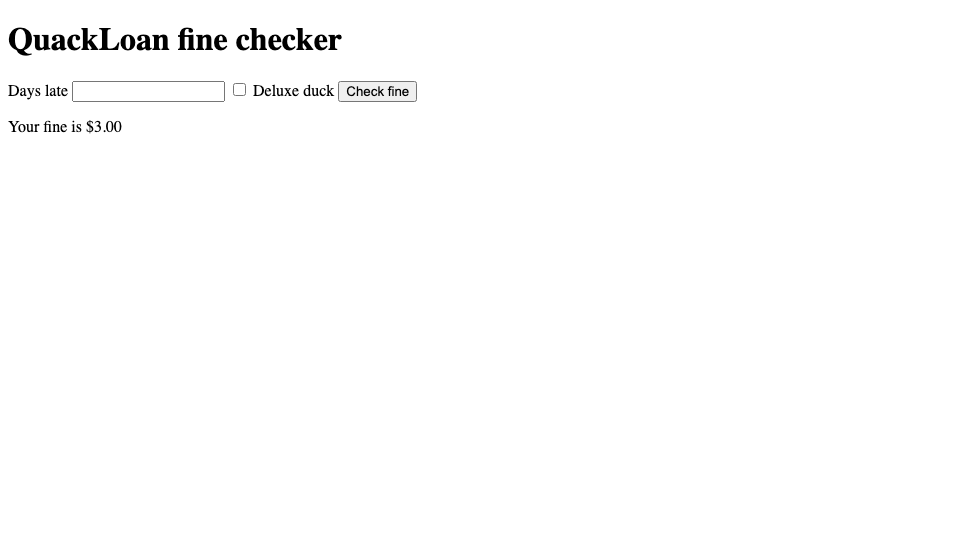

# Week 9 lab output

Prepared with Codex assistance on 13 October 2026 for https://github.com/nethren/week9-lab.

## Working application

For `GET /fine?days=5&deluxe=1`:

```json
{"days_late": 5, "deluxe": true, "fee": 3.0}
```

The browser journey displays **Your fine is $3.00**. The expected value comes from the Week 6 brief: `(5 - 2) x $0.50 x 2 = $3.00`, below the $5 cap.

`GET /health` returns `{"status":"ok"}`. Missing/non-numeric/negative days return HTTP 400; the app translates invalid requests rather than exposing an uncaught server error.

## Verified local results

| Check | Observed result | Evidence |
| --- | --- | --- |
| Fee unit tests and Flask integration tests | All 15 pass | `evidence/final-tests.txt` |
| Ruff | Pass | `evidence/lint.txt` |
| Dependency audit | No known vulnerabilities found at run time | `evidence/audit.txt` |
| Healthy artifact smoke | Pass | `evidence/healthy-smoke.txt` |
| Healthy artifact Chromium journey | One test passes | `evidence/healthy-e2e.txt` |
| Missing error handler | Negative-days integration test errors; other tests pass | `evidence/missing-error-handler.txt` |
| Missing Deluxe checkbox value | Source tests and smoke pass; E2E fails, actual $1.50 versus expected $3.00 | `evidence/checkbox-mutation-source-tests.txt`, `evidence/checkbox-mutation-e2e.txt` |
| Package omits `duckfine.py` | Package cannot start: `ModuleNotFoundError: No module named 'duckfine'`; local smoke/E2E blocked by startup | `evidence/packaging-mutation-app.txt` |

Local artifact experiments ran using Python 3.14 on macOS and Chromium. GitHub Actions uses Python 3.13 on Linux. Local packaging results are recorded separately from CI results in `evidence/local-results.json`.



## Verified GitHub experiments

| Pull request | Observed CI result | Integration result |
| --- | --- | --- |
| [#1: JSON endpoints and pipeline](https://github.com/nethren/week9-lab/pull/1) | Lint, test, audit, package and smoke pass | Merged |
| [#2: Browser journey](https://github.com/nethren/week9-lab/pull/2) | Lint, test, audit, package, smoke and E2E pass | Merged; E2E made a required check |
| [#3: Broken checkbox](https://github.com/nethren/week9-lab/pull/3) | Only E2E fails; source checks and smoke pass | GitHub reports `BLOCKED`; closed without merging |
| [#4: Missing packaged module](https://github.com/nethren/week9-lab/pull/4) | Lint, test, audit and package pass; smoke and E2E fail | GitHub reports `BLOCKED` on the broken revision; copy line then restored |

The failure runs are [checkbox run](https://github.com/nethren/week9-lab/actions/runs/38335879559) and [packaging run](https://github.com/nethren/week9-lab/actions/runs/38335913806). Full failure logs and the pre-fix merge states are saved in `evidence/github-*-failure.txt` and `evidence/github-*-gate.json`. The corrected #4 revision restores the original package contents; its latest checks are visible on the pull request.

All five checks (`lint`, `test`, `audit`, `smoke`, `e2e`) are required, pull requests are required, and branch protection applies to administrators. Production requires `nethren` as reviewer, permits self-review for this solo lab, and disallows administrator bypass. Environment deployments are limited to protected branches. The saved API snapshots in `evidence/` verify the actual settings.

## What the experiments establish

1. Removing `try/except` is caught by `test_negative_days_is_a_400_not_a_crash`. DuckFine's unit tests expect the model to raise `ValueError`; only the route test checks translation into HTTP 400. It is a boundary fault.
2. The package is built once in `package`. Both `smoke` and `e2e` download and run the zip from an extracted directory. The source tests alone cannot catch missing deployment files.
3. The app has two direct runtime dependencies, Flask and apig-wsgi, but the inspected CI zip contains **eight Python distributions**: Flask 3.1.3, apig-wsgi 2.20.0, blinker 1.9.0, click 8.5.0, itsdangerous 2.2.0, Jinja2 3.1.6, MarkupSafe 3.0.4, and Werkzeug 3.1.9. The SPDX file has nine package records: those eight plus the root `build/` entry. All eight distribution versions are pinned in `requirements.txt` to preserve the resolution checked here.
4. A checked HTML checkbox without an explicit value submits `on`. The page expects `1`, so it silently quotes the standard fee. API integration tests and HTTP smoke tests do not drive the HTML form; the browser test does.
5. Continuous delivery pauses for an accountable person to inspect the release evidence and approve production. Automatic approval would remove the human decision this lab is demonstrating.

## Scope and remaining steps

AWS Academy access was unavailable and the user requested completion of the code and GitHub parts. Staging and production jobs therefore print explicit placeholders. No Lambda resources, cloud endpoints, AWS deployment hashes or cloud smoke-test results are claimed.

Production requires `nethren` to approve the deployment in GitHub. Review the green checks and artifact evidence first. Approving the current placeholder job demonstrates GitHub's review pause; it does not deploy an application to AWS.

For real AWS deployment, follow `README.md` and activate the provided `pipeline-with-aws-deploy.yml.txt` after setting the two functions, environment variables and temporary environment secrets. The build-once artifact and AWS `CodeSha256` equality check are ready in that template, but hash equality has not been observed against AWS.

## Source and method

Official Week 9 lab, pp. 1-6 and Appendices A-D; official Week 6 lab, p. 1; instructor-provided Week 9 reference code. Those materials permit generated code and the provided reference implementation. The provided browser test was used instead of a manually recorded codegen session, as permitted in step 24. No claim is made that a personal recording or manual production review occurred.

The app and pipeline follow the reference; fee coverage, missing-input/health assertions, version pins and repeatable local experiments were added. AI-assisted output was checked with tests and actual fault experiments. These checks establish specific observed behaviours, not universal correctness or customer validation.
